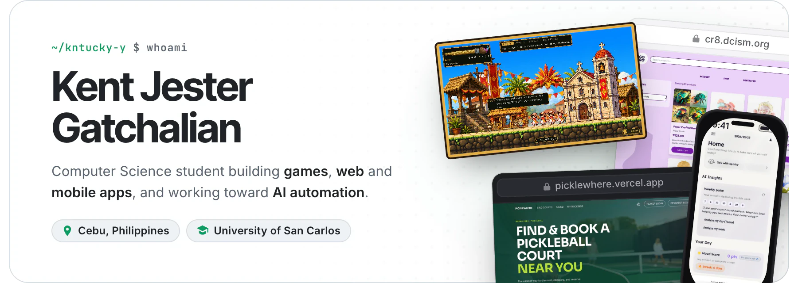
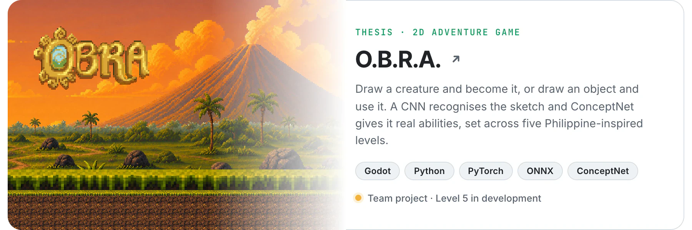
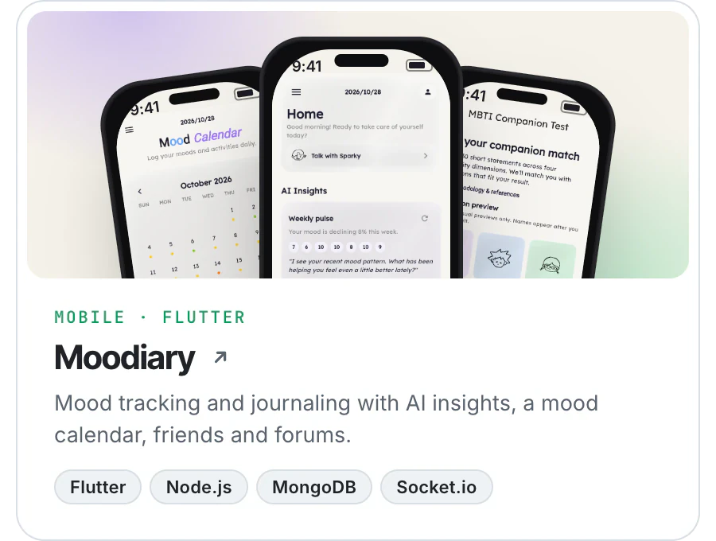
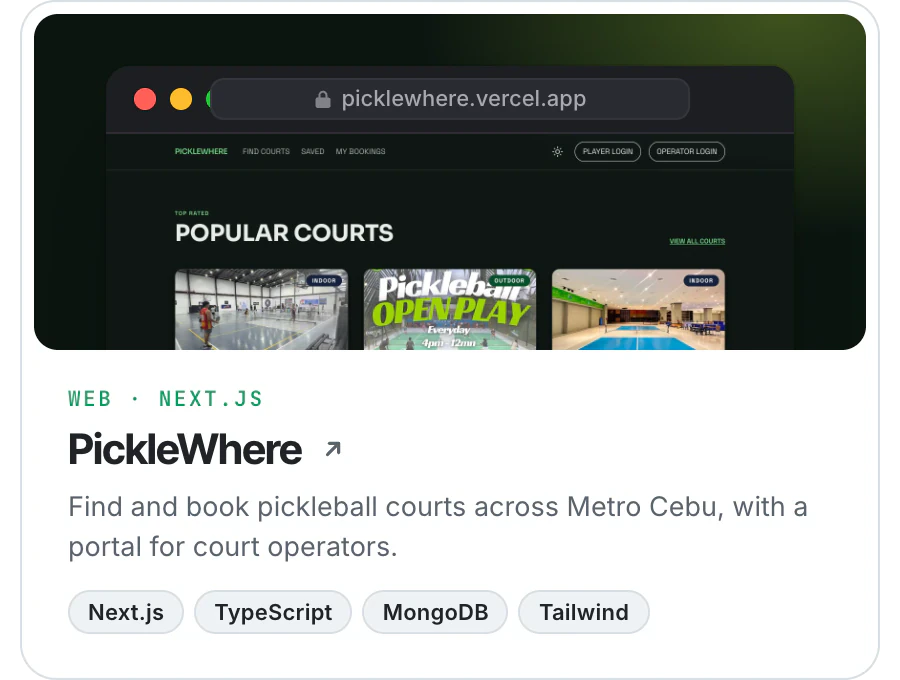
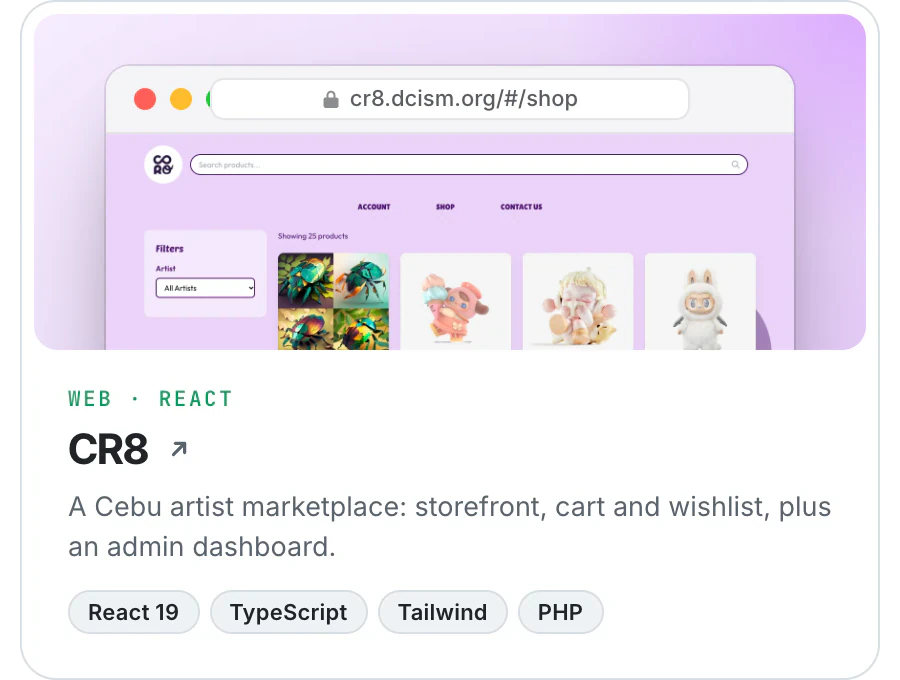
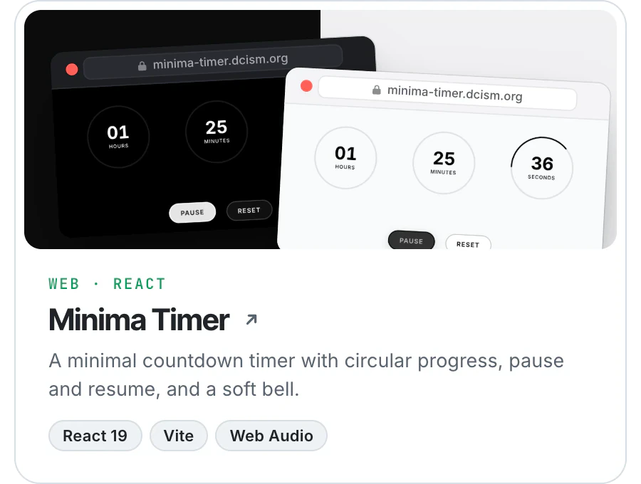

<picture>
  <source media="(prefers-color-scheme: dark)" srcset=".github/readme/header-dark.webp" />
  
</picture>

### Featured work

<a href="https://github.com/hyuuuan/OBRA">
  <picture>
    <source media="(prefers-color-scheme: dark)" srcset=".github/readme/card-obra-dark.webp" />
    
  </picture>
</a>

  <a href="https://github.com/kntucky-y/Moodiary"><picture><source media="(prefers-color-scheme: dark)" srcset=".github/readme/card-moodiary-dark.webp" /></picture></a><!--
  --><a href="https://picklewhere.vercel.app"><picture><source media="(prefers-color-scheme: dark)" srcset=".github/readme/card-picklewhere-dark.webp" /></picture></a>

  <a href="https://github.com/kntucky-y/CR8"><picture><source media="(prefers-color-scheme: dark)" srcset=".github/readme/card-cr8-dark.webp" /></picture></a><!--
  --><a href="https://github.com/kntucky-y/Minima-Timer"><picture><source media="(prefers-color-scheme: dark)" srcset=".github/readme/card-minima-dark.webp" /></picture></a>

### Toolbox

<picture>
  <source media="(prefers-color-scheme: dark)" srcset="https://skillicons.dev/icons?i=ts%2Cjs%2Cpy%2Cdart%2Cjava%2Ccs%2Cphp%2Cc%2Creact%2Cnextjs%2Cflutter%2Cnodejs%2Cexpress%2Ctailwind%2Cvite%2Cdotnet%2Cgodot%2Cpytorch%2Cfastapi%2Cmongodb%2Cfirebase%2Cvercel%2Cgit%2Cgithub%2Cvscode%2Cpostman&perline=13&theme=dark" />
  
</picture>

  <b>AI and LLMs</b>&nbsp;&nbsp;Groq · Llama · Gemini · GPT · Claude 
  <b>Cloud</b>&nbsp;&nbsp;Vercel · DigitalOcean App Platform · Render · Railway 
  <b>APIs</b>&nbsp;&nbsp;Google Places · OpenStreetMap · Firebase Cloud Messaging · Resend

### Right now

- Building **Level 5 (Mayon)** of [O.B.R.A.](https://github.com/hyuuuan/OBRA), our thesis game
- Getting deeper into **AI automation** and putting LLMs to work inside real apps

 

